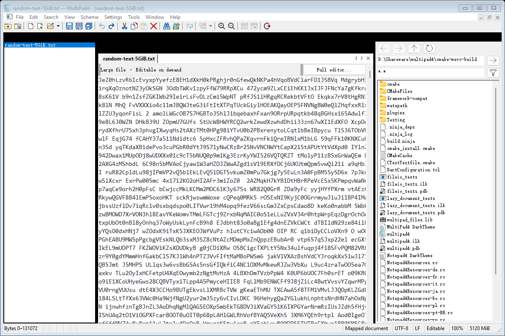

# MultiPad4

English | [简体中文](README_zh.md)

**MultiPad4** is a Windows-only tabbed MDI text editor built with C++20, WTL, and notepad4's optimized Scintilla. It adapts notepad4's editing features to a multi-document workflow and adds a Notepad++-style search interface, a plugin compatibility layer, and a Matepath file browser.

As of **2026-11-13**, routing is in place for **418/418 distinct menu commands** in notepad4's static resource inventory. File and encoding operations, advanced editing, styles, completion, settings, background tasks, and session restoration have implementations; the default large-file path supports on-demand editing and saving. **Full behavioral parity testing is still in progress**: command routing does not establish that every behavior matches upstream.

See [PROJECT_SCOPE.md](docs/PROJECT_SCOPE.md) for project goals and document isolation rules, [MIGRATION_STATUS.md](docs/MIGRATION_STATUS.md) for the notepad4 migration record, and [MIGRATION_ACCEPTANCE.md](docs/MIGRATION_ACCEPTANCE.md) for itemized evidence and pending acceptance checks. Later developments are covered in the feature documents linked below.

## Current features

- **Multiple documents and docking**: Real MDI child windows, tab switching and drag reordering, independent undo stacks, Ctrl+Tab, and cascading/tiling. Document, search-result, and plugin panes support docking, floating, and hiding.
- **Files and encodings**: Open multiple files, drag and drop, command-line arguments, single-instance/window reuse, Save/Save As/Save Copy/Save All, reload, and close protection. UTF-8, UTF-16, and code-page detection/conversion, BOM and line-ending preservation, file variables, backups, history, and favorites.
- **Editing and languages**: Advanced selection and line operations, case/number/encoding conversion, sorting, alignment, and insertion. The complete upstream lexer configuration catalogue, language detection, schemes/fonts/themes, folding, bookmarks, occurrence highlighting, completion, auto-indent, auto-pairing, and LaTeX input.
- **Find and replace**: A unified modeless Find/Replace/Find in Files/Mark dialog with normal, extended-escape, and regular-expression modes, counting, and searches/replacements in the current or all open documents. The results pane provides hierarchical folding, match highlighting, and navigation. Ctrl+F / Ctrl+H / Ctrl+Shift+F / Ctrl+M open the corresponding tabs; F7 shows results.
- **Directory search**: File filters, recursion, hidden-directory options, cancellation, and error counts. Disk-file searches use up to eight background threads; open documents use their current unsaved buffers. File replacement retains confirmation, encoding, and atomic-save rules, with independent undo for replacements in open documents.
- **UI and settings**: notepad4 menus, shortcuts, multilingual resources, 27 toolbar button types with layout customization, and a 13-part status bar. Global/document settings, INI persistence, autosave history, file watching, session restoration, tools/run commands, printing, and system-integration entry points.

The search interface adapts Notepad++'s layout and interactions, with English and Simplified Chinese labels. Its modeless dialog follows the active document while retaining the query. See [Search UI migration](docs/SEARCH_MIGRATION.md) and [File/directory search](docs/FILE_SEARCH.md). Directory search does not yet provide a fully streaming memory model or `.gitignore` rules; file replacement still runs one file at a time on the UI thread.

### On-demand large-file editing

By default, files **≥300 MiB** use an editable on-demand document. Read-only sliding mappings, a persistent piece tree, an append-only edit journal, and lazy line indexes retain the full document state, while Scintilla displays an editing window of approximately 128 KiB around the current position. Opening and ordinary typing do not require copying the entire file or building a complete line table first.

This mode supports editing at the beginning, middle, and end of a file, global undo/redo, saving to the original path, and saving a copy. Full-document search, regular expressions, replacement, counting, Find All, marking, and jumps to line starts operate directly on the document model. Expensive single-document operations can run in the background and be canceled; plain-text scans use up to eight threads.

In the existing warm-cache benchmark, the median time across five runs to open a 5 GiB file and display an editable first screen was approximately **9.7 ms**. This result applies to the specified machine and data, excludes process startup, and does not measure full-file scanning. Saving the entire file and building an exact line index for the first time still have linear costs. Editor plugins, global multi-selection, full-document Select All, printing, and some encoding/advanced operations require explicitly switching to a complete Scintilla document through `Full editor...`.

See [On-demand editable documents](docs/MAPPED_EDITING.md) and [Parallel large-file search](docs/PARALLEL_SEARCH_EXPERIMENT.md) for implementation details, benchmark conditions, raw data, and compatibility limits.



### Matepath file browser

Open the independent docking pane through Window → Matepath File Browser. It supports directory navigation, back/forward/parent navigation, file filters, hidden files, sorting, refresh, locating the active document, and opening/activating tabs. Directory and pane settings can be saved with application settings. The embedded Shell directory list does not require a separate matepath process.

The upstream directory API still has a `MAX_PATH` limit. Refresh is manual, and loading icons in large directories can pause navigation. See [Matepath integration](docs/MATEPATH_MIGRATION.md).

OpenDocuments and Matepath save pane visibility, docking side and position, dock size, and floating window coordinates on exit in `plugins/Config/OpenDocuments.ini` and `plugins/Config/Matepath.ini`. The next launch restores this layout, including the dock position of hidden panes.

### Notepad++ plugins and plugin management

Unicode x64 plugins are loaded from `plugins/<name>/<name>.dll` under the executable directory. The host provides plugin menus, shortcuts, notifications, message routing to the active document, and docking panes. Integration checks use real JsonTools, XMLTools, mimeTools, NppConverter, and NppExport DLLs.

Plugins → Plugins Admin supports catalogue search and batch installation, updates, removal, disabling, and enabling. Operations run after restart confirmation and document-save handling, verify downloads with SHA-256, and retain logs and recovery information on failure. Plugin management requires Windows PowerShell 5.1 and a writable installation directory.

The compatibility layer implements only part of the Notepad++ API. **A plugin's presence in the catalogue does not establish compatibility.** The catalogue is a pinned snapshot and does not refresh automatically over the network. External lexers, dual views, and the complete dark-theme API are among the features not provided. Loading diagnostics are written to `plugins/Config/MultiPad4-plugin-load.log`. See [PLUGINS.md](docs/PLUGINS.md) for the compatibility layer; the newer [PLUGIN_ADMIN.md](docs/PLUGIN_ADMIN.md) takes precedence for plugin management.

## Frameworks and source

- WTL 10: `3rdparty/wtl`.
- Daniel Bowen's WTL Tabbing Framework: `3rdparty/TabbingFramework`.
- Sergey Klimov's WTL Docking Framework: `3rdparty/DockingFramework`.
- notepad4 application source and resource baseline: `3rdparty/notepad4`.
- notepad4's optimized Scintilla: `3rdparty/notepad4-scintilla/scintilla`.
- Matepath Shell directory list: `3rdparty/matepath`.
- Notepad++ search/plugin-management reference resources and plugin API: `3rdparty/notepad-plus-plus`, `3rdparty/notepad-plus-plus-plugin-api`.

The main frame uses the Docking Framework's `CDockingFrameImplBase` to wrap `CTabbedMDIFrameWindowImpl`; document windows derive from `CTabbedMDIChildWindowImpl`. The application uses a real `MDICLIENT` and `WS_EX_MDICHILD` windows. The earlier custom docking algorithms and `CTabViewImpl` are no longer part of the production implementation.

Third-party snapshots are preserved unchanged. `cmake/FrameworkCompatibility.cmake` and `cmake/Matepath.cmake` generate host-compatible copies in the build directory. The notepad4 baseline is `3fcfb70fd0d3c8802100c85f7293ccb326aa8b64`. See [THIRD_PARTY.md](THIRD_PARTY.md) for provenance, pinned revisions, and licenses.

## Building

Requires Windows 10/11, VS 2022 Desktop development with C++ (including ATL and the Windows SDK), CMake 3.25+, Ninja, and C++20. Qt and MFC are not required.

From the repository root, run the following in a terminal with the x64 MSVC environment initialized, such as an x64 VS Developer Command Prompt:

```powershell
cmake -S . -B cmake-msvc-build -G Ninja -DCMAKE_CXX_COMPILER=cl -DCMAKE_BUILD_TYPE=RelWithDebInfo -DBUILD_TESTING=ON -DMULTIPAD4_SIMD=SSE4.2
cmake --build cmake-msvc-build --parallel
ctest --test-dir cmake-msvc-build --output-on-failure
.\cmake-msvc-build\multipad4.exe + .\src\MainFrame.cpp .\src\FileIO.cpp
```

The `msvc-x64` configure/build/test presets in `CMakePresets.json` are also available. CMake creates the build directory automatically. Production builds do not depend on `tmp` or online downloads.

The GitHub Actions [Windows Build](.github/workflows/msvc-build.yml) workflow runs on pushes, pull requests, and manual dispatch. It builds x64 Release variants on Windows 2022 with eight toolchains: MSVC, Clang-CL, Intel oneAPI, MINGW64 GCC/Clang, UCRT64 GCC/Clang, and CLANG64. Each toolchain builds SSE4.2, AVX2, and AVX512 using the corresponding `MULTIPAD4_SIMD` value, for 24 build jobs. Artifacts are named `multipad4-<toolchain>-x64-<SIMD>` and contain `multipad4.exe` and `MultiPad4 DarkTheme.ini`; MinGW and oneAPI artifacts also include their toolchain runtime DLLs. This workflow only builds the application; it does not run tests. A failure in one variant does not cancel the others.

### MinGW-w64 / OpenATL

A MinGW-w64 x64 build uses the pinned MIT-licensed OpenATL snapshot instead of
Microsoft ATL. Install GCC, binutils (windres), CMake, Ninja, and Python 3.10+.
The existing local wrappers select the MinGW64 toolchain by directory name:

```powershell
New-Item -ItemType Directory -Force cmake-mingw64-build
bash -lc "cmake-reconfigure cmake-mingw64-build"
bash -lc "cmake-build cmake-mingw64-build"
ctest --test-dir cmake-mingw64-build --output-on-failure
```

On other machines, the `mingw64-x64` configure/build/test presets can be used
from an MSYS2 MinGW64 terminal. Keep the selected toolchain's `bin` directory
on PATH when launching the executable, or deploy its runtime DLLs alongside it.
No Microsoft ATL or Visual Studio installation is needed for this build.
OpenATL, WTL, and the tabbing/docking snapshots remain unchanged; compatibility
patches are applied to build-directory copies. See [THIRD_PARTY.md](THIRD_PARTY.md).

### SIMD build options

`CMakeLists.txt` provides the `MULTIPAD4_SIMD` cache option with three choices, defaulting to `SSE4.2`. The application, file layer, complete lexer configuration catalogue, and Scintilla use the same instruction-set setting. AVX2/AVX512 enable the corresponding branches in upstream `VectorISA.h`. Configuration checks both the option value and compiler support so unsupported `/arch` flags are not silently ignored.

| CMake option | MSVC / oneAPI compiler flag |
|---|---|
| `-DMULTIPAD4_SIMD=SSE4.2` | `/arch:SSE4.2` |
| `-DMULTIPAD4_SIMD=AVX2` | `/arch:AVX2` |
| `-DMULTIPAD4_SIMD=AVX512` | `/arch:AVX512` |

For example, configure with `cmake --preset msvc-x64 -DMULTIPAD4_SIMD=AVX2` in a VS Developer Command Prompt, then build with the corresponding build preset. All three variants require an x64 toolchain. The executable requires CPU and operating-system support for the selected instruction set; there is no automatic runtime fallback.

Application-side SIMD is used for UTF-8/UTF-16/ASCII detection, line-ending statistics, indentation detection, and some graphics operations. See [SIMD_MIGRATION.md](docs/SIMD_MIGRATION.md) for boundary regression checks and scope.

## Validation

CMake currently defines **nine regular tests** and conditionally registers `notepadpp_plugins` when all five plugin DLLs listed above are present in the build directory, bringing the total to ten. CI currently builds only and does not run these tests.

| CTest name | Main coverage |
|---|---|
| `scintilla_line_index` | LF/CRLF/CR line counts and offsets across scalar/SIMD boundaries, with both line-index widths |
| `fileio_roundtrip` | Encodings, Chinese/emoji, line endings, invalid input, and failed-save protection |
| `editor_integration` | Real WTL/Scintilla windows, MDI isolation, commands/UI, search/replace, styles, settings, sessions, autosave, and Matepath |
| `simd_boundaries` | Guard pages, random input, invalid/truncated encodings, line endings across blocks, and graphics tail boundaries |
| `lazy_document` | Piece tree, random edits, snapshots, transactions, undo/redo, index reuse, and failed-save protection |
| `large_file_integration` | On-demand view editing/saving, full-document search/replace, cancellation, encodings, and conversion to the full editor |
| `file_search` | Serial/parallel consistency, directory filtering, encodings, regex, open-document handoff, and cancellation |
| `single_instance_integration` | Process startup and single-instance/window reuse; skipped if a MultiPad4 window is already open |
| `plugin_admin_worker` | Enable/disable/removal in isolated temporary directories, batch preflight checks, and rejection of invalid metadata |
| `notepadpp_plugins` (conditional) | Commands, panes, exports, and document routing for five real plugins |

Generate the resource inventory, command-routing report, and rendered windows with:

```powershell
python tools/inventory_notepad4.py
.\cmake-msvc-build\multipad4.exe --migration-report tmp/migration-status-check.json
python tools/check_migration.py tmp/migration-status-check.json
.\cmake-msvc-build\multipad4.exe --qa-render tmp/qa-render
```

Resource counts and command routing establish entry-point coverage only. Window rendering and automated regression checks do not replace interactive acceptance testing. Behavioral parity across all languages, dialogs, and dynamic menus, mouse dragging, IME input, multi-monitor DPI, actual printing, and real system integration still require individual verification.
