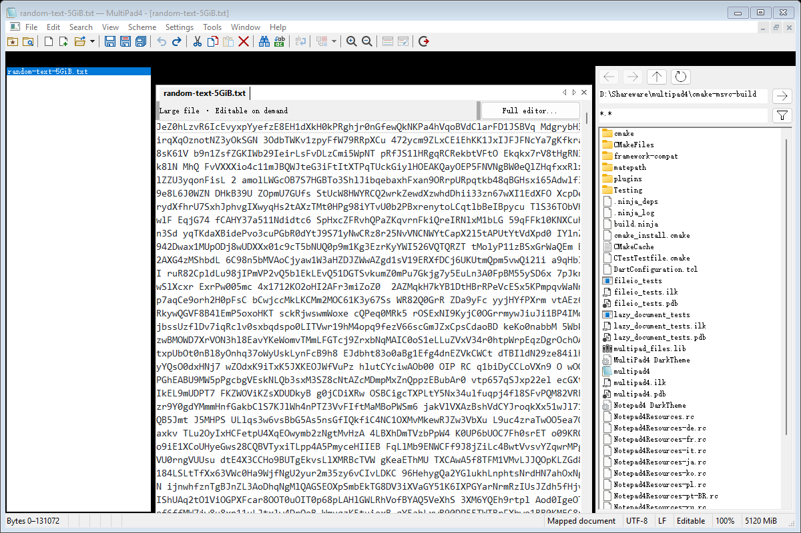

# MultiPad4

English | [简体中文](README_zh.md)

**MultiPad4** is a Windows x64 tabbed MDI text editor built with C++20, WTL, and notepad4's optimized Scintilla. It brings notepad4's editing features to a multi-document workflow with on-demand large-file editing, Notepad++-style search, and dockable plugin panes.

The About dialog shows `v0.3`, and Windows executable metadata reports `0.3.0.0`.

Behavioral parity with notepad4 is still being verified. See [project scope](docs/PROJECT_SCOPE.md), [migration history](docs/MIGRATION_STATUS.md), and [acceptance checks](docs/MIGRATION_ACCEPTANCE.md).

## Current features

- **Multiple documents and docking.** Real MDI child windows, tab switching and drag reordering, independent undo stacks, Ctrl+Tab, and cascading/tiling. Search results and plugin panes can dock, float, or hide. Use **Settings → Document Tab Settings** to choose the tab title font, size, and variable or fixed width. Maximized documents show the file type icon beside the menu bar.
- **Files and encodings.** Open multiple files, drag and drop, use command-line arguments or single-instance reuse, and use Save, Save As, Save Copy, or Save All. The editor detects and converts UTF-8, UTF-16, and code pages, preserves BOMs and line endings, and supports file variables, backups, history, and favorites. Windows file change notifications can prompt for reload or automatically reload unmodified documents, depending on the monitoring mode.
- **Editing and languages.** Advanced selection and line operations, conversion, sorting, alignment, and insertion. The editor supports language detection, folding, bookmarks, occurrence highlighting, completion, auto-indent, auto-pairing, and LaTeX input.
- **Find and replace.** A modeless Find/Replace/Find in Files/Mark dialog supports plain text, extended escapes, regular expressions, counting, and search/replace in the current or all open documents. Ctrl+F focuses the Find field. Ctrl+H, Ctrl+Shift+F, and Ctrl+M open the other tabs. F7 shows results with folding, match highlighting, and navigation. The search dialog has English and Simplified Chinese labels. [Search UI](docs/SEARCH_MIGRATION.md)
- **Directory search.** Windows thread pools run up to eight search workers with file filters, recursion, hidden-directory options, cancellation, and error counts. Open files are searched using their current buffers, including unsaved edits. Large decoded snapshots and dense match lists spill to temporary files, and the results pane displays matches in pages. Directory searches use the dialog's filters and traverse independently of `.gitignore`. Replacement runs one file at a time on the UI thread and preserves confirmation, encoding, atomic saves, and per-document undo. [File search](docs/FILE_SEARCH.md) · [Performance changes](docs/PERFORMANCE_CHANGES.md) · [Thread pools](docs/THREADING.md)
- **UI and Windows integration.** The Window and Plugins menus and Plugins Admin use localized resources. The editor offers a configurable toolbar, a 13-part status bar, INI settings, autosave history, session restoration, run commands, and printing. **Settings → File Associations** registers extensions and embedded file type icons for the current user. Select MultiPad4 as the default handler in Windows Default Apps. [File type icons](res/icons/README.md)

### Language and style

The editor loads 90 language configurations from `config/languages/default.xml` and falls back to embedded defaults if needed. Open **Language and Style** (Ctrl+F12) to edit syntax colors, fonts, keywords, and additional extensions, preview changes in the active document, and apply them to the current document or to all documents, including new ones.

The editor ships with 24 presets in its native XML format, including light and dark palettes and 22 converted Notepad++ presets. Theme import accepts MultiPad4 XML. [Language configuration](docs/LANGUAGE_CONFIGURATION.md) · [Bundled themes](config/themes/README.md)

### On-demand large-file editing

By default, files **≥300 MiB** use an editable on-demand document. Read-only sliding mappings, a persistent piece tree, an append-only edit journal, and lazy line indexes retain the full document state, while Scintilla displays an editing window of approximately 128 KiB around the current position. Opening and ordinary typing do not require copying the entire file or building a complete line table first.

This mode supports editing at the beginning, middle, and end of a file, global undo/redo, saving to the original path, and saving a copy. Full-document search, regular expressions, replacement, counting, Find All, marking, and jumps to line starts operate directly on the document model. Expensive single-document operations can run in the background and be canceled; plain-text scans use up to eight threads.

In the existing warm-cache benchmark, the median time across five runs to open a 5 GiB file and display an editable first screen was approximately **9.7 ms**. This result applies to the specified machine and data, excludes process startup, and does not measure full-file scanning. Saving the entire file and building an exact line index for the first time still have linear costs. Editor plugins, global multi-selection, full-document Select All, printing, and some encoding/advanced operations require explicitly switching to a complete Scintilla document through `Full editor...`.

See [On-demand editable documents](docs/MAPPED_EDITING.md) and [Parallel large-file search](docs/PARALLEL_SEARCH_EXPERIMENT.md) for implementation details, benchmark conditions, raw data, and compatibility limits.



### Bundled docking plugins

**Plugins → Matepath → File Browser** opens the Shell-based file browser. It supports back/forward/parent navigation, file filters, hidden files, sorting, manual refresh, locating the active document, and opening or activating tabs. The upstream directory API has a `MAX_PATH` limit, and loading icons in large directories can pause navigation. [Matepath plugin](docs/MATEPATH_MIGRATION.md)

**Plugins → OpenDocuments → Open Documents** opens a list synchronized with tab order, the active document, and unsaved changes. Double-click an entry or press Enter to switch to it. [OpenDocuments plugin](docs/OPEN_DOCUMENTS_PLUGIN.md)

Both plugins are built as separate DLLs by default. They store and restore pane visibility, dock position and size, and floating coordinates in `plugins/Config/OpenDocuments.ini` and `plugins/Config/Matepath.ini`. To omit either plugin from a build, set `MULTIPAD4_BUILD_OPEN_DOCUMENTS=OFF` or `MULTIPAD4_BUILD_MATEPATH=OFF`.

### Notepad++ plugins and plugin management

Unicode x64 plugins are loaded from `plugins/<name>/<name>.dll` under the executable directory. The host provides plugin menus, shortcuts, notifications, message routing to the active document, and docking panes. Integration checks use real JsonTools, XMLTools, mimeTools, NppConverter, and NppExport DLLs.

Plugins → Plugins Admin supports catalogue search and batch installation, updates, removal, disabling, and enabling. Operations run after restart confirmation and document-save handling, verify downloads with SHA-256, and retain logs and recovery information on failure. Plugin management requires Windows PowerShell 5.1 and a writable installation directory.

The compatibility layer implements only part of the Notepad++ API. **A plugin's presence in the catalogue does not establish compatibility.** The catalogue is a pinned snapshot and does not refresh automatically over the network. External lexers, dual views, and the complete dark-theme API are among the features not provided. Loading diagnostics are written to `plugins/Config/MultiPad4-plugin-load.log`. See [PLUGINS.md](docs/PLUGINS.md) for the compatibility layer; the newer [PLUGIN_ADMIN.md](docs/PLUGIN_ADMIN.md) takes precedence for plugin management.

## Frameworks and source

- WTL 10: `3rdparty/wtl`.
- Daniel Bowen's WTL Tabbing Framework: `3rdparty/TabbingFramework`.
- Sergey Klimov's WTL Docking Framework: `3rdparty/DockingFramework`.
- notepad4 application source and resource baseline: `3rdparty/notepad4`.
- notepad4's optimized Scintilla: `3rdparty/notepad4-scintilla/scintilla`.
- Matepath Shell directory list: `3rdparty/matepath`.
- Notepad++ search/plugin-management reference resources and plugin API: `3rdparty/notepad-plus-plus`, `3rdparty/notepad-plus-plus-plugin-api`.

The main frame uses the Docking Framework's `CDockingFrameImplBase` to wrap `CTabbedMDIFrameWindowImpl`; document windows derive from `CTabbedMDIChildWindowImpl`. The application uses a real `MDICLIENT` and `WS_EX_MDICHILD` windows. The earlier custom docking algorithms and `CTabViewImpl` are no longer part of the production implementation.

Third-party snapshots are preserved unchanged. `cmake/FrameworkCompatibility.cmake` and `cmake/Matepath.cmake` generate host-compatible copies in the build directory. The notepad4 baseline is `3fcfb70fd0d3c8802100c85f7293ccb326aa8b64`. See [THIRD_PARTY.md](THIRD_PARTY.md) for provenance, pinned revisions, and licenses.

## Building

Requires Windows 10/11, VS 2022 Desktop development with C++ (including ATL and the Windows SDK), CMake 3.25+, Ninja, and C++20. Qt and MFC are not required.

From the repository root, run the following in an x64 VS Developer Command Prompt.

```powershell
cmake --preset msvc-x64
cmake --build --preset msvc-x64
ctest --preset msvc-x64
.\cmake-msvc-build\multipad4.exe + .\src\MainFrame.cpp .\src\FileIO.cpp
```

The `msvc-release` preset enables link-time optimization in Release builds. The local development wrappers and their setup are documented in [AGENTS.md](AGENTS.md).

The Windows Build workflow runs on pushes, pull requests, and manual dispatch. It builds 24 x64 Release variants on Windows Server 2022 across eight toolchains (MSVC, Clang-CL, Intel oneAPI, MINGW64 GCC/Clang, UCRT64 GCC/Clang, and CLANG64) and three SIMD targets (SSE4.2, AVX2, and AVX512). Each artifact contains `multipad4.exe`, `config/`, both bundled plugin DLLs with their notices, and toolchain runtime DLLs where needed. On a tag push, the workflow publishes `multipad4-<toolchain>-x64-<SIMD>.zip` packages and generates release notes from commit messages. [Windows Build workflow](.github/workflows/msvc-build.yml)

### MinGW-w64 / OpenATL

A MinGW-w64 x64 build uses the pinned MIT-licensed OpenATL snapshot instead of
Microsoft ATL. Install GCC, binutils (windres), CMake, Ninja, and Python 3.10+.
The existing local wrappers select the MinGW64 toolchain by directory name:

```powershell
New-Item -ItemType Directory -Force cmake-mingw64-build
bash -lc "cmake-reconfigure cmake-mingw64-build"
bash -lc "cmake-build cmake-mingw64-build"
ctest --test-dir cmake-mingw64-build --output-on-failure
```

On other machines, the `mingw64-x64` configure/build/test presets can be used
from an MSYS2 MinGW64 terminal. Keep the selected toolchain's `bin` directory
on PATH when launching the executable, or deploy its runtime DLLs alongside it.
No Microsoft ATL or Visual Studio installation is needed for this build.
OpenATL, WTL, and the tabbing/docking snapshots remain unchanged; compatibility
patches are applied to build-directory copies. See [THIRD_PARTY.md](THIRD_PARTY.md).

### SIMD build options

`CMakeLists.txt` provides the `MULTIPAD4_SIMD` cache option with three choices, defaulting to `SSE4.2`. The application, file layer, native lexers, and Scintilla use the same instruction-set setting. CMake checks the selected value and compiler support at configure time.

| CMake option | MSVC / oneAPI compiler flag |
|---|---|
| `-DMULTIPAD4_SIMD=SSE4.2` | `/arch:SSE4.2` |
| `-DMULTIPAD4_SIMD=AVX2` | `/arch:AVX2` |
| `-DMULTIPAD4_SIMD=AVX512` | `/arch:AVX512` |

For example, configure with `cmake --preset msvc-x64 -DMULTIPAD4_SIMD=AVX2` in a VS Developer Command Prompt, then build with the corresponding build preset. All three variants require an x64 toolchain. The executable requires CPU and operating-system support for the selected instruction set; there is no automatic runtime fallback.

Application-side SIMD is used for UTF-8/UTF-16/ASCII detection, line-ending statistics, indentation detection, and some graphics operations. See [SIMD_MIGRATION.md](docs/SIMD_MIGRATION.md) for boundary regression checks and scope.

## Validation

With `BUILD_TESTING=ON`, CMake registers 14 tests and up to four more when Python, the bundled plugins, or the five third-party plugin DLLs are available. CI verifies build artifacts and runtime configuration. Run CTest locally for the application and plugin checks.

| CTest name | Main coverage |
|---|---|
| `scintilla_line_index` | LF/CRLF/CR line counts and offsets across scalar/SIMD boundaries, with both line-index widths |
| `fileio_roundtrip` | Encodings, Chinese/emoji, line endings, invalid input, and failed-save protection |
| `editor_integration` | Real WTL/Scintilla windows, MDI isolation, commands/UI, search/replace, styles, settings, sessions, autosave, and Matepath |
| `simd_boundaries` | Guard pages, random input, invalid/truncated encodings, line endings across blocks, and graphics tail boundaries |
| `lazy_document` | Piece tree, random edits, snapshots, transactions, undo/redo, index reuse, and failed-save protection |
| `large_file_integration` | On-demand view editing/saving, full-document search/replace, cancellation, encodings, and conversion to the full editor |
| `file_search` | Serial/parallel consistency, directory filtering, encodings, regex, open-document handoff, and cancellation |
| `single_instance_integration` | Process startup and single-instance/window reuse; skipped if a MultiPad4 window is already open |
| `plugin_admin_worker` | Enable/disable/removal in isolated temporary directories, batch preflight checks, and rejection of invalid metadata |
| `thread_pool` | Task lifetime, exception propagation, nested work, and concurrency limits |
| `lexer_configuration_baseline`, `lexer_behavior_baseline` | Language data and runtime lexer behavior against the pinned upstream baseline |
| `configuration_integration` | XML language configuration, native themes, and style configurator |
| `editor_without_plugins` | Editor and session behavior with plugin loading disabled |
| `configuration_data_equivalence`, `lexer_inventory_coverage` (Python) | XML data and resource inventory consistency |
| `bundled_pane_restart` (both bundled plugins enabled) | Docked, floating, and hidden pane layouts across process restarts |
| `notepadpp_plugins` (five DLLs present at configure time) | Commands, panes, exports, and document routing for five real plugins |

Generate the resource inventory, command-routing report, and rendered windows with:

```powershell
python tools/inventory_notepad4.py
.\cmake-msvc-build\multipad4.exe --migration-report tmp/migration-status-check.json
python tools/check_migration.py tmp/migration-status-check.json
.\cmake-msvc-build\multipad4.exe --qa-render tmp/qa-render
```

Resource counts and command routing establish entry-point coverage only. Window rendering and automated regression checks do not replace interactive acceptance testing. Behavioral parity across all languages, dialogs, and dynamic menus, mouse dragging, IME input, multi-monitor DPI, actual printing, and real system integration still require individual verification.
