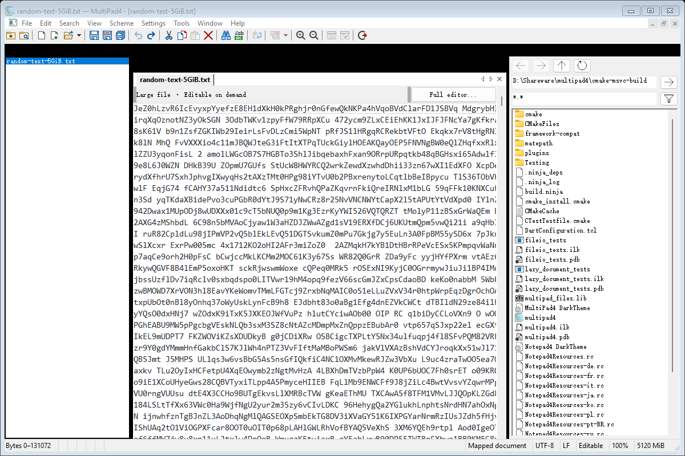

# MultiPad4

[English](README.md) | 简体中文

**MultiPad4** 是 Windows 专用的标签式 MDI 文本编辑器，使用 C++20、WTL 和 notepad4 优化版 Scintilla。项目以 notepad4 的编辑功能为基础，将单文档工作流适配为多文档，并接入 Notepad++ 风格的查找界面、插件兼容层和 Matepath 文件浏览器。

截至 **2026-11-13**，已建立 notepad4 静态资源清单中 **418/418 个不同菜单命令的路由**，文件/编码、高级编辑、样式、补全、设置、后台任务及会话恢复均已有实现；默认大文件路径已支持按需编辑和保存。**完整功能一致性验收仍在进行中**，入口覆盖不等于所有行为与上游一致。

项目目标与文档隔离规则见 [PROJECT_SCOPE.md](docs/PROJECT_SCOPE.md)，notepad4 迁移记录见 [MIGRATION_STATUS.md](docs/MIGRATION_STATUS.md)，逐项证据与待验收范围见 [MIGRATION_ACCEPTANCE.md](docs/MIGRATION_ACCEPTANCE.md)。后续专项进展见下文链接。

## 当前功能

- **多文档与停靠**：真实 MDI 子窗口、标签切换/拖动排序、独立撤销栈、Ctrl+Tab、层叠/平铺；文档、搜索结果和插件面板支持停靠、浮动与隐藏。
- **文件与编码**：多文件打开、拖入、命令行参数、单实例/窗口复用、保存/另存为/副本/全部保存、重载和关闭保护；UTF-8、UTF-16 与代码页检测转换、BOM/换行保留、文件变量、备份、历史和收藏夹。
- **编辑与语言**：高级选择与行操作、大小写/数字/编码转换、排序、对齐和插入；上游完整 lexer 配置目录、语言检测、方案/字体/主题、折叠、书签、出现项、自动补全/缩进/配对及 LaTeX 输入。
- **查找与替换**：统一的查找/替换/文件中查找/标记无模式对话框，支持普通、扩展转义、正则、计数、当前/所有打开文档查找替换；结果面板支持分层折叠、命中高亮和跳转。Ctrl+F / Ctrl+H / Ctrl+Shift+F / Ctrl+M 打开对应页，F7 显示结果。
- **目录搜索**：文件过滤、递归、隐藏目录选项、取消和错误统计；磁盘文件查找最多使用 8 个后台线程，打开文档使用当前未保存缓冲区。文件替换保留确认、编码及原子保存规则，打开文档中的替换可独立撤销。
- **UI 与设置**：notepad4 菜单、快捷键、多语言资源、27 种工具栏按钮及布局定制、13 段状态栏；全局/文档设置分层、INI 持久化、自动保存历史、文件监视、会话恢复、工具/运行、打印及系统集成入口。

查找界面采用 Notepad++ 布局与交互适配，标签目前支持英文和简体中文；无模式对话框跟随活动文档并保留查询。详见 [查找界面迁移](docs/SEARCH_MIGRATION.md) 和 [文件/目录搜索](docs/FILE_SEARCH.md)。目录搜索尚未实现完整流式内存模型或 `.gitignore` 规则；文件替换仍逐文件在 UI 线程执行。

### 按需大文件编辑

默认 **≥300 MiB** 的文件进入按需可编辑文档：只读滑窗映射、持久化片段树、追加编辑日志和惰性行索引保存全文状态，Scintilla 仅显示当前位置附近约 128 KiB 的编辑窗口。打开和普通键入无需先复制全文或建立完整行表。

支持文件头/中部/尾部编辑、全局撤销/重做、原路径保存及保存副本；全文查找、正则、替换、计数、Find All、标记及行起点跳转直接作用于文档模型。单文档耗时操作可在后台执行并取消，普通文本扫描最多使用 8 个线程。

现有热缓存测试中，5 GiB 文件打开到可编辑首屏的五轮中位数约 **9.7 ms**；结果针对指定机器与数据，不包含进程启动，也不代表全文扫描耗时。全文保存和首次精确行索引仍有线性成本。编辑器插件、全局多选、全文件全选、打印及部分编码/高级操作需要通过 `Full editor...` 显式切换到完整 Scintilla 文档。

实现、性能条件、原始数据与兼容边界见 [按需可编辑文档](docs/MAPPED_EDITING.md) 和 [大文件并行查找](docs/PARALLEL_SEARCH_EXPERIMENT.md)。



### Matepath 文件浏览器

通过“窗口 → Matepath 文件浏览器”打开独立停靠面板，支持目录导航、前进/后退/上一级、文件过滤、隐藏文件、排序、刷新、定位活动文档及打开/激活标签。目录与面板设置可随应用设置保存。采用内嵌 Shell 目录列表，无需启动独立 matepath 程序。

当前仍受上游目录 API 的 `MAX_PATH` 限制，刷新为手动触发，大目录加载图标可能暂停导航。详见 [Matepath 集成](docs/MATEPATH_MIGRATION.md)。

### Notepad++ 插件与插件管理

从可执行文件目录的 `plugins/<名称>/<名称>.dll` 加载 Unicode x64 插件，提供插件菜单、快捷键、通知、活动文档消息路由及停靠面板。已有使用 JsonTools、XMLTools、mimeTools、NppConverter、NppExport 真实 DLL 的集成检查。

“插件 → 插件管理...”支持目录搜索及批量安装、更新、移除、禁用和启用；确认重启并处理文档保存后执行，下载校验 SHA-256，失败时保留日志与恢复资料。插件管理需要 Windows PowerShell 5.1 和可写安装目录。

兼容层仅实现部分 Notepad++ API，**目录中列出插件不代表该插件已兼容**。目录使用固定版本快照，不会自动联网刷新；外部 lexer、双视图和完整暗色主题 API 等尚未提供。加载诊断位于 `plugins/Config/MultiPad4-plugin-load.log`。兼容层说明见 [PLUGINS.md](docs/PLUGINS.md)，插件管理以更新的 [PLUGIN_ADMIN.md](docs/PLUGIN_ADMIN.md) 为准。

## 框架与源码

- WTL 10：`3rdparty/wtl`。
- Daniel Bowen 的 WTL Tabbing Framework：`3rdparty/TabbingFramework`。
- Sergey Klimov 的 WTL Docking Framework：`3rdparty/DockingFramework`。
- notepad4 应用源码与资源基线：`3rdparty/notepad4`。
- notepad4 优化版 Scintilla：`3rdparty/notepad4-scintilla/scintilla`。
- Matepath Shell 目录列表：`3rdparty/matepath`。
- Notepad++ 查找/插件管理参考资源与插件 API：`3rdparty/notepad-plus-plus`、`3rdparty/notepad-plus-plus-plugin-api`。

主框架以 Docking Framework 的 `CDockingFrameImplBase` 包装 `CTabbedMDIFrameWindowImpl`；文档窗口派生自 `CTabbedMDIChildWindowImpl`。应用使用真实 `MDICLIENT` 和 `WS_EX_MDICHILD` 子窗口。原先自建的停靠算法及 `CTabViewImpl` 已退出正式实现。

第三方快照保持原样，`cmake/FrameworkCompatibility.cmake` 和 `cmake/Matepath.cmake` 在构建目录生成宿主兼容副本。notepad4 基线为 `3fcfb70fd0d3c8802100c85f7293ccb326aa8b64`；来源、固定提交和许可见 [THIRD_PARTY.md](THIRD_PARTY.md)。

## 构建

需要 Windows 10/11、VS 2022 的 C++ 桌面开发组件（含 ATL 与 Windows SDK）、CMake 3.25+、Ninja 和 C++20。无需 Qt 或 MFC。

在已初始化 x64 MSVC 环境的终端（如 x64 VS Developer Command Prompt）中，从仓库根目录执行：

```powershell
cmake -S . -B cmake-msvc-build -G Ninja -DCMAKE_CXX_COMPILER=cl -DCMAKE_BUILD_TYPE=RelWithDebInfo -DBUILD_TESTING=ON -DMULTIPAD4_SIMD=SSE4.2
cmake --build cmake-msvc-build --parallel
ctest --test-dir cmake-msvc-build --output-on-failure
.\cmake-msvc-build\multipad4.exe + .\src\MainFrame.cpp .\src\FileIO.cpp
```

也可使用 `CMakePresets.json` 中的 `msvc-x64` configure/build/test presets。CMake 会自动创建构建目录；正式构建不依赖 `tmp` 或在线下载。

GitHub Actions 的 [MSVC Build](.github/workflows/msvc-build.yml) 在 push、PR 或手动触发时，使用 Windows 2022 / VS 2022 分别编译 SSE4.2、AVX2、AVX512 三档 x64 Release。每档使用对应的 `MULTIPAD4_SIMD` 参数，并分别上传 `multipad4-msvc-x64-SSE4.2`、`multipad4-msvc-x64-AVX2`、`multipad4-msvc-x64-AVX512` artifacts，包含 `multipad4.exe` 和配套的 `MultiPad4 DarkTheme.ini`；该工作流只构建程序，不运行测试。一档失败不取消其它档位的构建。

### SIMD 编译选项

`CMakeLists.txt` 提供三选一的 `MULTIPAD4_SIMD` 缓存开关，默认 `SSE4.2`。应用、文件层、全部 lexer 配置和 Scintilla 使用同一指令集设置；AVX2/AVX512 会启用上游 `VectorISA.h` 中对应的条件分支。配置时会检查参数是否合法及编译器是否支持，避免无效 `/arch` 参数被忽略。

| CMake 开关 | MSVC / oneAPI 编译参数 |
|---|---|
| `-DMULTIPAD4_SIMD=SSE4.2` | `/arch:SSE4.2` |
| `-DMULTIPAD4_SIMD=AVX2` | `/arch:AVX2` |
| `-DMULTIPAD4_SIMD=AVX512` | `/arch:AVX512` |

例如，在 VS Developer Command Prompt 中使用 `cmake --preset msvc-x64 -DMULTIPAD4_SIMD=AVX2` 配置，再使用对应 build preset 编译。三档均要求 x64 工具链；可执行文件要求 CPU 和操作系统支持所选指令集，不进行运行时自动降级。

应用侧 SIMD 已用于 UTF-8/UTF-16/ASCII 检测、换行统计、缩进检测和部分图形操作，边界回归与适用范围见 [SIMD_MIGRATION.md](docs/SIMD_MIGRATION.md)。

## 验证

当前 CMake 定义 **8 项常规测试**，在构建目录具备上述五个插件 DLL 时额外注册 `notepadpp_plugins`（共 9 项）。CI 当前只编译，不运行这些测试。

| CTest 名称 | 主要范围 |
|---|---|
| `fileio_roundtrip` | 编码、中文/emoji、换行、错误输入及失败保存保护 |
| `editor_integration` | 真实 WTL/Scintilla 窗口、MDI 隔离、命令/UI、查找替换、样式、设置、会话、自动保存及 Matepath |
| `simd_boundaries` | 保护页、随机输入、非法/截断编码、跨块换行及图形尾部边界 |
| `lazy_document` | 片段树、随机编辑、快照、事务、撤销/重做、索引复用及保存失败保护 |
| `large_file_integration` | 按需视图编辑/保存、全文查找替换、取消、编码及完整编辑器转换 |
| `file_search` | 串行/并行一致性、目录过滤、编码、正则、打开文档交接与取消 |
| `single_instance_integration` | 进程启动和单实例/窗口复用；已有 MultiPad4 窗口时跳过 |
| `plugin_admin_worker` | 隔离临时目录中的启停/移除、批处理预检查及非法元数据拒绝 |
| `notepadpp_plugins`（条件注册） | 五个真实插件的命令、面板、导出及文档路由 |

资源清单、命令路由与窗口渲染可分别生成：

```powershell
python tools/inventory_notepad4.py
.\cmake-msvc-build\multipad4.exe --migration-report tmp/migration-status-check.json
python tools/check_migration.py tmp/migration-status-check.json
.\cmake-msvc-build\multipad4.exe --qa-render tmp/qa-render
```

资源数量和命令路由只证明入口覆盖；窗口渲染与自动回归也不替代真实交互验收。全部语言/对话框/动态菜单的行为一致性、鼠标拖动、输入法、多显示器 DPI、实际打印及真实系统集成仍需逐项验证。
