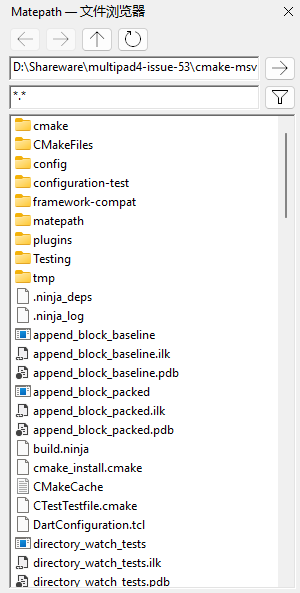
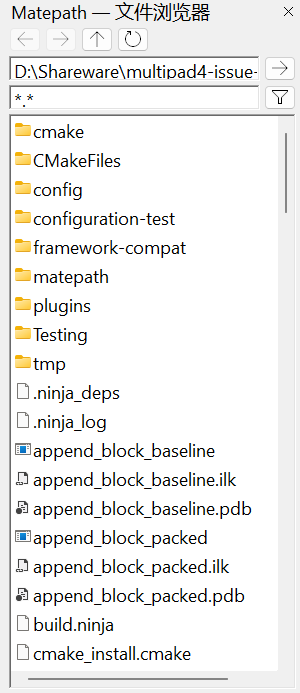

# GUI font DPI updates (#99)

The issue screenshot highlights Matepath's address edit control; its filter edit
and file list also use tiny text while the title is normal. Those native controls
used the fixed `DEFAULT_GUI_FONT`, which does not adapt to each window's DPI.

Native application controls now use the system message font obtained with
`SystemParametersInfoForDpi`, owned and reused at that DPI. The shared pane base
applies it after creation and on DPI transitions, covering Matepath address/filter/
list/tooltips and Open Documents. Docked captions use the pane's font. Status bar,
toolbar/tooltips and the Fast View label/button use the same helper. Font ownership
remains local to each window so different DPI windows do not share a mutable font.
Custom icon fonts retain their existing size rules. Scintilla controls retain their
configured point sizes and zoom; native WM_SETFONT is never applied to them.

The Windows-10 Scintilla build already reads the actual window DPI in SurfaceGDI
and SurfaceD2D and rebuilds font data on WM_DPICHANGED_AFTERPARENT. Its older-OS
dynamic DPI loader is excluded by this project's target and is not needed. No
manual document zoom multiplier was added.

## Validation and screenshots

The `dpi_fonts` CTest uses actual bundled Matepath/OpenDocuments DLLs. It passed
in 4.51 s. It checks address edit, filter edit, list, Open Documents and status
font heights against the system metrics at 96/144/192/96: 12/18/24/12 pixels on
this machine. Forty further transitions do not leak GDI objects. Document text,
peer state and user zoom remain unchanged.

It enumerated both real monitors, moved the real frame onto each and processed
their actual window notifications. Both monitors report 96 DPI, GUI height 12
and Scintilla sample width 144. A physical 150%/mixed-DPI monitor is unavailable
here. Synthetic 144/192 notifications test native font dispatch and GDI metrics;
they do not change the real DPI queried by Scintilla surfaces, so they are not
claimed as proof of physical monitor migration.

Both screenshots were exported from this test process and actually inspected.
The 144-DPI image demonstrates 18-pixel native text in existing controls; it is
not a screenshot of a physical 150% desktop. The address, filter and file list
are readable without clipped rows. Layout/icon dimensions still follow each
window's real monitor DPI. Raw actual-monitor and synthetic font metrics are
included alongside these images.

Raw records: [font metrics](DPI_FONTS_METRICS.csv) and
[actual monitor measurements](DPI_FONTS_NATIVE_MONITORS.csv).
After integrating settings master `862e426`, the wrapper build linked and
`frame_refresh`, `dpi_fonts` and `settings_profile` all passed (3/3, 3.02 s;
the DPI test itself took 1.11 s). The captured screenshots and metrics above
precede that unrelated settings integration.

The final test entry lives in `tests/TestMain.cpp`; production `src/main.cpp`
remains four lines. DPI checks still load the bundled plugins, use isolated
settings, and retain plugin shutdown/unload checks. After this entry migration,
the actual wrapper build linked and `frame_refresh`, `dpi_fonts`,
`theme_enumeration` and inventory coverage all passed (4/4, 3.49 s). Unchanged
performance workloads were not repeated.

The wrapper build linked successfully after removing an inapplicable legacy-OS
loader call. Full editor smoke was attempted and failed at the existing timed
Completion budget assertion (line 100); it is not reported as passed. Physical
IME, actual 150% startup, and real mixed-DPI dragging remain manual checks.
