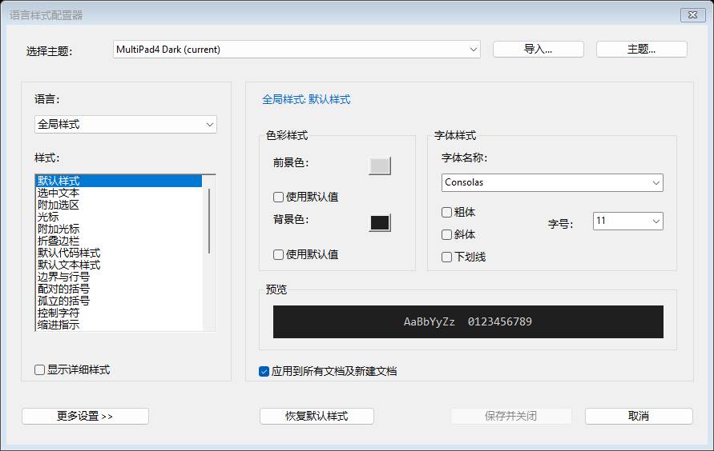
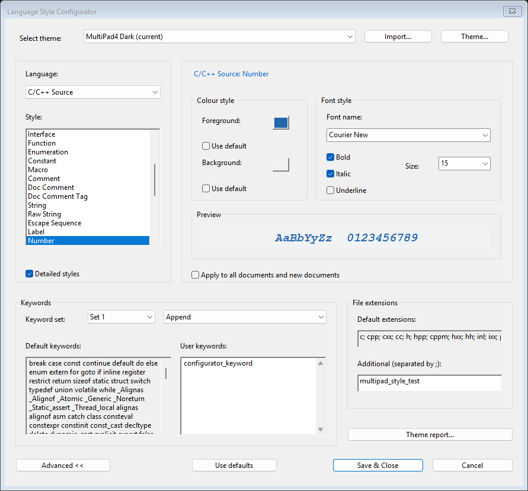

# XML 语言配置与主题

程序从程序目录的 `config/languages/default.xml` 加载 90 项语言配置。
同一份源 XML 同时编入资源，外部文件缺失或损坏时可恢复启动。
原生 C++ lexer 继续 AOT 编译；正式程序不链接 `stl*.cpp`。
`lexer_baseline_export` 只供开发校验使用，不参与产品默认文件生成。

## 加载、覆盖与生命周期

默认路径通过 EXE 位置解析，与工作目录无关。用户目录沿用现有
`AppSettings` 的目录选择（包括 `MULTIPAD4_SETTINGS` 覆盖），子目录为
`config/languages`、`config/themes`。用户语言 XML 按文件名排序合并。
持久覆盖、文档覆盖与主题先校验合并为文档快照中的最终样式；UI 回调读取已应用的快照，
编辑中的全局定义不会透到其他文档。快照独立保存配置、规则和主题版本。
加载使用 Windows 自带 XmlLite，无新增第三方解析库或许可证。
DTD、外部实体/解析器被禁用；最大文件 8 MiB、嵌套深度 32、节点数
100,000、每节点属性 64、文本 2 Mi UTF-16 字符。支持 UTF-8 和 UTF-16 BOM。
不兼容主版本、重复身份、缺字段、数值越界和未知必需元素拒绝加载；
`x-` 可选元素可忽略并诊断。主题解析/映射报告显示文件与位置。

语言配置先完整解析、校验引擎与样式绑定，再原子发布共享只读快照。
失败保留最近有效快照；初次失败使用内嵌默认值。文档和补全缓存持有
定义的共享引用，旧文档及对话框不会引用释放后的字符串。
引擎、属性接口及样式绑定属于程序能力，外部 XML 不能注册未知引擎、
任意 SCI 消息或新增本地词法状态。一个引擎可以绑定多个独立语言定义。

可从菜单 **Language Style Configurator…** 选择原生主题、导入 MultiPad4 原生 XML、
预览、重载、重置和查看主题报告。预览作用于当前文档，Cancel 恢复原引用；
Save & Close 可以选择当前文档或全部文档（包括随后新建文档）。应用后保存为用户目录
中的原生 XML 副本，不改写导入源。主题选择与文档会话分别持久化。
内置主题同时包含 Notepad++ 的全部 22 个发行预设（Monokai、Obsidian、Solarized、
Zenburn 等），可直接在主题下拉框中选择，无需逐个导入。这些预设已一次性转换为 MultiPad4 原生 XML，随程序分发的配置全部采用
`<theme version="1">`。产品代码仅处理自己的配置格式，原有 Notepad++ XML 解析分支、
语言/样式编号映射表均已删除；导入外部格式会被拒绝。源主题的作者注释及许可保留在转换文件中。
完整列表和来源见 [主题说明](../config/themes/README.md)，原生主题验证见
[内置主题验证报告](performance/bundled-native-themes.tsv)。
配置器参照 Notepad++ 使用紧凑的左右分栏，支持简体中文及英文界面。
左侧选择语言及样式，默认使用可读的分组名称；勾选“显示详细样式”可进一步编辑独立词法类别。
右侧显示实际生效的颜色、字体及字号，不再用空字段表示继承。色块可直接打开颜色选择器，
“使用默认值”移除该颜色的主题覆盖；字体和字号使用可输入的下拉框，并提供“继承默认”选项。
粗体、斜体和下划线使用普通复选框；“恢复默认样式”移除当前样式的主题覆盖。
使用独立的隐藏编辑器解析生效样式，浏览其他语言不会改变活动文档的语言或文本。
字体和颜色修改后自动预览；示例区显示所选样式。输入无效值时保留最近的有效预览并显示错误，
取消关闭会还原打开对话框时的主题。未修改时禁用“保存并关闭”。

关键词、文件扩展名收在“更多设置”中。关键词按引擎支持的集合编号显示，提供默认词表以及
继承 / 追加 / 替换模式；替换配合空文本可显式清空集合。附加扩展名不带点，以分号分隔，
随主题范围生效并保存，与已有语言/INI 扩展名相加。切换主题保留本次对话框内各主题的草稿；
主题菜单中的重新加载 / 恢复默认主题显式丢弃当前主题草稿。主题诊断在独立窗口中查看。
已有 INI 用户覆盖和文档临时覆盖仍按下述层次优先于主题。





**Reload language configuration** 重新读取语言配置并更新打开的文档；加载失败不
留下半应用状态。首轮没有文件监视器或后台 XML 解析。

## 语言 schema v1

`default.xml` 是完整且可编辑的数据源，保留所有数值元数据、关键词槽位
（包括 null、空值、排序/补全属性）、默认缩进/折叠/转义、分组样式、补全片段、
资源本地化标识及来源。`variants` 保存全部 39 个菜单方言、默认方言、稳定变体 ID、
引擎参数和扩展名；`aliases` 保存独立于显示名的语言别名。内容嗅探保留为原生检测逻辑。`categories` 把语义类别绑定到本地样式，绑定形状由
内嵌的同源默认 XML 校验。数值绑定不是公共主题契约。

用户可放置较小的增量文件：

```xml
<language-overrides version="1">
  <language id="cpp">
    <extensions mode="replace">c; cpp; h; hpp; custom</extensions>
    <field name="defaultTabWidth" value="2"/>
    <slot index="0" mode="append">project_keyword</slot>
  </language>
</language-overrides>
```

未指定字段继承上一层。`replace` 明确替换（正文为空表示显式空值）；
`append` 仅用于词表；`inherit` 不为当前层写入覆盖。改变词表会清除该槽位的
PreSorted 标志，防止追加后沿用已排序假设。支持覆盖扩展名、缩进、折叠、
语言属性和代码字体选择；引擎绑定与语义映射必须保持为受支持的形状。
主题的附加关键词只接受显式映射的、对应引擎实际支持的槽位。

旧方案索引、语言资源 ID、样式索引与名称保留在迁移清单中。
新首选项使用稳定语言 ID、会话变体 ID 和语义样式组 ID；加载时新键优先，缺少时读旧键。
保存同时保留旧格式供回滚。旧分组覆盖应用到组内每个词法类别；会话恢复
把它们扩展到缺少的语义覆盖，已有新覆盖不被重复迁移覆盖。
原 INI 导入/导出仍然使用上游名称。

## 原生主题 schema v1

```xml
<theme version="1" name="Example">
  <style id="editor.default" fg="D0D0D0" bg="202020" font="Consolas" size="12"/>
  <style id="cpp.keyword" fg="80C0FF" decorations="1"/>
  <style id="cpp.comment.line" fg="80A080" decorations="0"/>
  <style id="editor.selection" bg="446688"/>
  <style id="cpp.number" clear="font,decorations"/>
  <extensions language="cpp">custom; project</extensions>
  <keywords language="cpp" slot="0" mode="append">project_keyword</keywords>
</theme>
```

`fg/bg` 为六位 RGB；字体大小为 2～512；装饰位是 bold=1、italic=2、underline=4。
`decorations="0"` 显式清除装饰。缺字段继承；`clear` 将指定字段恢复为编辑器
默认值；空 `font` 清除主题字体选择；`inherit="true"` 不产生当前层覆盖。
主题关键词允许 append、replace、inherit。独立原生主题不需要包含所有语言。
缺失类别根据所选编辑区背景亮度选择内部浅/深回退，避免暗色主题继承浅色调色板。
默认语言样式 → 内部浅/深主题 → 选择的主题 → 用户持久覆盖 → 文档临时覆盖。
分组覆盖与独立类别覆盖分层处理，后者可以区分 C++ 行注释/块注释、字符/字符串。
宏、转义、格式串、模板字符串等缺失类别有显式语义回退，其余继承内部默认值。

配置文件只通过稳定语义样式 ID 指定本地样式，不接受外部应用的样式编号、节点名称或字段别名。
编辑区、选区、光标、行号、括号、空白、当前行、折叠栏具有独立目标。
缺失类别沿用上面定义的原生继承层次；可选扩展和未知语义 ID 的诊断在主题报告中查看。

## 验证和性能

`configuration_data_equivalence` 比较全部配置字段与 P0 编译对象导出；
`lexer_behavior_baseline` 比较实际引擎逐字节样式、折叠、检测和补全位图。
`configuration_integration` 验证恶意/损坏 XML、Unicode、字体重置、精确颜色、
独立类别、MDI 隔离、模态预览取消、缓存所有权、重新加载和增量/全量一致性。
示例测试主题为项目自行编写，不依赖个人主题目录。

Release 测量和参考主题报告的复现命令、数据与限制见性能报告。
纯主题切换重用相同规则版本，不重新创建 lexer、不无条件全文 COLOURISE；
字体通过 Scintilla 样式 API 使布局失效。文本未着色区域仍按需着色，不能把 idle
styling 当作后台线程。当前没有并发 lexer；原生 lexer 的共享可变状态（包括
`LexCPP.cxx::isObjCSource`）不允许直接并发调用。
