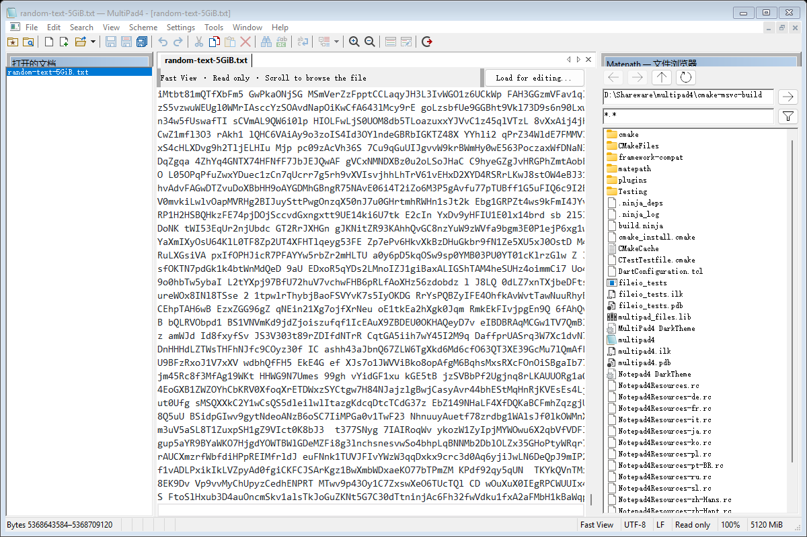

# 大文件首屏优化：按需 Fast View

MultiPad4 对 **300 MiB（314572800 字节，含边界）及以上**文件默认使用只读 Fast View。首屏只读取当前位置附近的有界窗口，不校验全文，不建立全文行表，也不在后台偷偷装载全文。小文件继续使用完整 Scintilla 编辑模型。不修改 `3rdparty/`。

## 实测瓶颈

下面是初版粗粒度计时的历史结果。后续已改用高精度计时并实测读取后端与并行度，精确数据及原始逐轮记录见 [全文读取性能报告](LARGE_FILE_READ_PERFORMANCE.md)；不要用下表做精确阶段归因。

原有滑窗映射方案虽然去掉了全文字符串副本，但最终仍把全文灌入 Scintilla。文件映射本身不会消除后续全文工作。

对现有 `tmp/random-text-5GiB.txt` 的完整装载增加分段计时后，一轮结果如下（本机 Release/SSE4.2，缓存状态未统一控制）：

| 阶段 | 时间 |
|---|---:|
| 创建预分配文档 | 0 ms，低于本次计时粒度 |
| 读取、UTF-8 校验、解码及回调间开销 | 2954 ms |
| 换行扫描及行表预分配 | 329 ms |
| Scintilla 文本写入、行索引构建 | 1983 ms |
| lexer / 样式配置 | 0 ms，低于本次计时粒度 |

计时字段见 `EditorDocument::loadMetrics`。初始化预分配没有成为这轮计时的主要成本，不能把全部延迟归因于分配。最主要的是全文读取/校验以及全文文本/行表构建。此前端到端完整打开测得 8–11 秒，文件缓存会显著影响结果。

## 新路径

- `MainFrame::Open`、重新加载及指定编码重新加载在读取正文前判断大小，调用 `EditorDocument::OpenFastFile`。
- `FastFileView` 拥有真实源文件和全局字节位置。现有 Scintilla 仅绘制约 128 KiB 的局部文本，不冒充整份文件。
- `files::MappedFile` 复用文件层的只读滑窗映射，按系统分配粒度对齐，单个映射最多 64 MiB，失败缩小并回退到有界 `ReadFile`。只访问需要显示的内容，映射长度不等于实际读取量。
- 首部约 4 KiB 样本检测编码，BOM 和显式编码优先；每次翻页只在邻近区域找行边界、校验和解码。首屏不等待全文编码验证。
- 全局滚动条按文件字节位置定位，支持鼠标滚轮、方向键、Page Up/Down、Ctrl+Home/End 和滚动条首尾/拖动。相邻窗口在完整换行处衔接，超长 UTF-8 行用有界片段显示。
- 不显示虚构的全文行数或局部行号。状态栏显示当前源字节区间和真实文件大小，会话保存源字节位置。
- 视图明确标注 `Fast View · Read only`，提供 `Load for editing...` 按钮及 File 菜单命令。局部选区可以复制；全选、全文件查找、全文编辑和插件命令需完整载入，避免把窗口片段当作完整文件处理。
- 保存副本直接分块复制源文件所有原始字节，保留原子替换及硬链接回滚语义；不会只保存当前窗口。只读浏览不允许覆盖原文档。
- 点击载入编辑后使用之前的流式全文装载路径，完整成功后才切换；失败保留原视图和只读状态。撤销、修改标记、全文搜索、编辑及流式保存随后恢复可用。
- 明确要求编码转换、换行转换、全局行跳转、全文查找、指定 lexer 或打印的命令行参数会选择完整装载，以保持这些命令的全文语义。
- 插件不接收局部视图的文件打开、活动缓冲和文本修改通知；载入编辑后恢复通知。Fast View 期间禁用插件命令，不能声称局部窗口是兼容的完整 Scintilla 文档。

## 首屏结果

下面测量 `MainFrame::Open` 加同步 `RedrawWindow(...RDW_UPDATENOW | RDW_ALLCHILDREN)`，测试时主窗口可见，包含新文档首屏绘制；不包含进程启动、全局配置加载。文件缓存状态未统一控制，不是冷盘延迟保证。

| 文件 | 打开至首屏 | 打开阶段源读取请求 | 此时进程峰值工作集 |
|---|---:|---:|---:|
| 2 GiB，来自已有随机文本前 2 GiB | 15 ms，前一轮 500 ms | 167944 字节 | 31 MiB |
| 原有 5 GiB 随机文本，5368709120 字节 | 16 ms | 167944 字节 | 31 MiB |

最终版本两份文件的四分之一、中点、末尾和 EOF 定位均通过，全部这些定位合计请求 626713 字节，未读取中间数 GiB 内容。读取计数是应用请求量，未测量操作系统预读量。



## 构建与复现

```powershell
bash -lc "cmake-build cmake-msvc-build"
ctest --test-dir cmake-msvc-build --output-on-failure

$env:MULTIPAD4_LARGE_TEST_SOURCE = (Resolve-Path tmp/random-text-5GiB.txt).Path
$env:MULTIPAD4_LARGE_TEST_QA = "$PWD/tmp/fast-view-qa" # 可选：导出本测试窗口截图
$env:MULTIPAD4_LARGE_TEST_PROFILE = '1' # 可选：另外完整载入，输出分段耗时
.\cmake-msvc-build\multipad4.exe --large-file-test
Remove-Item Env:MULTIPAD4_LARGE_TEST_SOURCE
Remove-Item Env:MULTIPAD4_LARGE_TEST_QA
Remove-Item Env:MULTIPAD4_LARGE_TEST_PROFILE
```

默认 `large_file_integration` 生成约 320 MiB 文本，验证首屏有界读取、只读保护、完整副本逐字节一致、滚轮与滚动条、连续分页、EOF、重新加载、转入编辑、完整行数/长度/末行定位、编辑修改标记、装载失败保护、普通文件隔离，以及 UTF-8 BOM / UTF-16 LE / BE 的分页、代理对与正文 U+FEFF 保留。

`MULTIPAD4_LARGE_TEST_MIB=2049` 或 `5120` 可扩大默认合成用例，会生成源文件并保存副本，需要相应磁盘空间。

## 边界

Fast View 是只读按需浏览，不是常量时间完成全文编辑准备。完整编辑、全文件查找、全局行号跳转仍需要全文载入；此前基于 `Text()` 的高级命令、打印、导出和插件仍可能申请大块内存。这个成本不再阻塞默认打开和首屏。

编码检测是样本推测，尚未显示的无效序列在访问时才会报错；可用指定编码重新加载。状态式编码（例如 UTF-7、ISO-2022）明确拒绝；超长无换行 DBCS 行在无法证明字符边界的随机位置要求载入编辑，避免静默错位。

映射期间源句柄使用 `FILE_SHARE_READ`，保持浏览和保存副本的数据一致；其他程序可能无法同时写入或替换源文件，关闭 Fast View 后解除。慢盘、网络盘、缺页 I/O 异常、跨 DPI 拖动仍需在目标环境手工验证。
