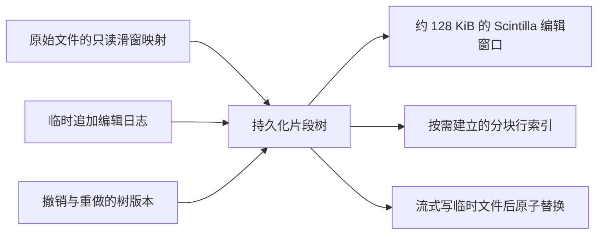
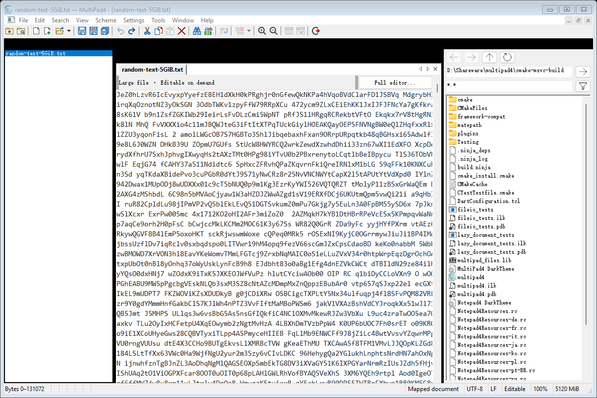

# 按需可编辑大文件文档

默认 ≥300 MiB 文件现在直接进入可编辑的映射文档。打开和首次编辑不等待全文复制、全文校验或完整行表。原 `FastFileView` 类名作为已有集成接口保留，但它已从只读预览变为局部编辑视图。

本次删除未采用的直接填充、连续缓冲接管、COW gap buffer 及独立片段数组实验代码和构建插桩；原始数据仍在 `docs/performance/` 中归档。保留已提交的缓冲读取和并行 SIMD 校验，用于普通文件及显式完整编辑器模式。

## 文档模型



`large::Document` 使用不可变 treap 节点；节点保存字节数、原始来源区间及子树。修改按位置拆分、合并并复制相关树路径，未修改原文以引用保留。预期查找/修改树元数据为 O(log P)，P 为片段数。新增文本追加到临时文件，原文不搬动；删除和撤销不复制被删除正文。

编辑事务保存修改前后树根及光标/选区，支持全局撤销和重做。保存点比较树版本；保存后撤销仍可访问原来的源版本。历史版本共享节点和来源，不是每次复制全文。

原始文件通过 `files::MappedFile` 按最多 64 MiB 的窗口映射，失败可回退有界读取。打开时只探测编码和建立可见窗口，不建立源文件全部片段或全部索引块。原文持有 FILE_SHARE_READ | FILE_SHARE_DELETE 句柄，防止其他程序原地改写，同时允许原路径原子替换。替换后旧映射仍属于原文版本，撤销所需内容不会指向新文件。

## 惰性和增量行索引

每个不可变文本来源按 64 KiB 建立索引块，仅在明确查询行号/总行数时按需物化。块内保留 32 位局部换行末尾偏移，块上层区间摘要使用 64 位总量。索引摘要记录 CR/LF 边界，跨块、跨片段 CRLF 计作一个换行。

原始数据源和追加数据段的索引缓存独立于文档树版本。编辑不会使原文件已建索引全部失效；只更新新树路径的摘要，必要时物化新文本段和边界块。已建立的未变区域可以复用。没有将一份可增长的全局行起点数组预分配到某个测试文件的规模。

首次精确请求末尾行号或总行数，仍可能扫描尚未索引的源区间；这项工作由异步行跳转触发，可取消，不阻塞默认打开或普通键入。只有字节位置和局部视图信息的状态栏不会暗中触发完整索引，也不显示虚构的全文行号。

## 可见窗口与编辑

Scintilla 只保存并绘制当前位置附近的约 128 KiB 解码文本。它的局部修改通知被翻译为原始编码下的全局范围替换，提交到片段树。键入、删除、剪切/粘贴和普通选区替换在事务内同步；全局撤销/重做恢复树版本并刷新需要显示的窗口。

UTF-8、UTF-8 BOM、UTF-16 LE/BE 及无 BOM UTF-16 的可见字符和编辑位置在边界显式转换。正文 U+FEFF 不被误当作 BOM 删除。窗口不会切断 UTF-8 字符、UTF-16 代理对或 CRLF。代码页文本在可证明字符边界的窗口内解码和编辑；无法表示的新字符会保留原文档并报错。

当前文档的全文件查找、计数、Find All、标记、批量替换和行跳转使用不可变快照在工作线程上执行。文档关闭、继续编辑或 Esc 会取消任务；结果只应用于仍匹配的树版本。行跳转按需建立经过区域的索引，不预先强制完整加载。

`Full editor...` 是显式兼容操作，从当前片段树流式构建完整 Scintilla 文档，而不是重新读取磁盘丢掉编辑。成功后才切换。普通键入不经过这个路径。

## 大文件查找替换

查找入口沿用现有对话框及快捷键，支持普通、扩展转义、正则/通配符、大小写、全词/词首、前后查找、循环、选区范围、跨行及 `. matches newline`。正则使用项目已固定的 Boost 引擎，通过带缓存的双向 Unicode 迭代器访问片段树；匹配范围不受 64 KiB 缓存或 128 KiB 视窗限制。匹配和捕获组保存原生编码下的 64 位字节位置。

替换沿用现有扩展转义、`$0`–`$9`、`\0`–`\9`、`$&`、`$$`、反斜杠转义及 `^c` 剪贴板内容语义。单次替换可处理超过视窗的匹配；批量替换在独立树分支上执行，成功后提交一个撤销版本。取消、异常或文档版本变化均不会提交部分替换。无上下文依赖的字面量替换扫描原快照一次并累计位置差；正则与词边界替换在修改后的分支继续匹配，以保持原编辑器的上下文语义。

字面量查找复用约 1 MiB 块；纯 ASCII 内容使用字节匹配，忽略大小写时用 SSE2 批量折叠 ASCII 大写字符。包含非 ASCII 文本的块使用 Unicode 查找与原生位置映射，DBCS 尾字节不会当作独立 ASCII 字符。正则按需保留四个约 64 KiB 原始缓存。特别大的捕获组替换/复制仍会按所请求的文本大小分配内存，不承诺任意表达式都使用固定内存或恒定时间。

计数仅保留总数；Find All/标记将固定大小的偏移记录写入自动删除的临时文件，避免每个命中都分配预览字符串。结果列表每次加载 1000 条，双击继续加载项可翻页；每条预览最多读取约 2 KiB，超长行不会被整体复制。Find All 所需的精确行索引也在线程中可取消地建立，可能增加一次全文索引成本。结果导航检查快照版本，修改后旧结果不会跳到无关文本。标记只绘制当前视窗，支持累积及清除。

支持混合普通/大文件的“所有打开文档”查找和替换，每个文档独立撤销；该跨文档入口沿用原同步调度。单文档耗时操作异步运行，可在正文按 Esc 取消，对话框状态在完成/失败/取消后更新。普通编辑器的原有查找替换路径保留。

回归检查覆盖普通 Scintilla 与映射模式的匹配位置/替换结果对比、CR/LF/CRLF、零宽匹配、捕获组、反向重叠字面量、超过视窗的匹配、跨缓存/片段匹配、UTF-8/UTF-16/Shift-JIS/GB18030、空字符转义、选区替换、结果分页、累积标记、只读与工作分支已修改后的取消保护。

### 5 GiB 查找替换实测

使用同一台 i9-12900HK / 约 32 GiB / Windows 11、MSVC RelWithDebInfo / SSE4.2。原测试文件为 5368709120 字节 ASCII 随机正文，在当前文档树末尾追加唯一标记，不改磁盘原文件。预热一轮后测三轮，不清系统文件缓存；计时包含启动工作线程、扫描、完成消息处理及结果应用，不包含进程启动与打开文件。查找从文件头到唯一末尾命中，计数及批量替换均扫描全文。

| 操作 | 中位数 | 最小–最大 |
|---|---:|---:|
| 区分大小写查找到末尾 | 6486.391 ms | 6139.529–6495.776 ms |
| 忽略大小写全文计数 | 7101.898 ms | 6764.264–7510.279 ms |
| 区分大小写全文批量替换（1 个命中） | 6116.293 ms | 6013.263–6562.410 ms |

每项读取请求约 5 GiB；替换仅向编辑日志新增 8 字节，没有重建 5 GiB Scintilla 文档。三轮均验证命中数、超过 32 位的末尾位置、替换后的字节和一次撤销还原；额外验证了末尾正则捕获组与取消保护，测试进程退出码为 0。计时点最大私有提交约 6.8 MiB，进程峰值工作集约 99.5 MiB；这些值针对该字面量/计数场景，不是任意正则或所有结果行的内存上限。

开发过程中的标量 ASCII 折叠版本，同条件三轮忽略大小写计数中位数为 33305.728 ms；SIMD 版本该项约快 4.69 倍。这个对照仅说明该 ASCII 路径的改善，不能推广到 Unicode/正则或打开文件速度。最初 Unicode 查找路径的单次计数观测约 38.8 秒，未作为稳定基线。全文搜索仍有线性扫描成本，不应与按需打开首屏的毫秒级时间混淆。

逐轮原始数据：[最终版本 CSV](performance/mapped-search-2026-11-13/5GiB.csv)、[标量折叠版本 CSV](performance/mapped-search-2026-11-13/5GiB-scalar-fold.csv)、[汇总 JSON](performance/mapped-search-2026-11-13/summary.json)。

复现本轮验证：

```powershell
$env:MULTIPAD4_LARGE_TEST_SOURCE = (Resolve-Path tmp/random-text-5GiB.txt).Path
$env:MULTIPAD4_LARGE_TEST_SEARCH = '1'
$check = Start-Process .\cmake-msvc-build\multipad4.exe --large-file-test -Wait -PassThru -RedirectStandardOutput tmp/search-benchmark.csv -RedirectStandardError tmp/search-benchmark.err
$check.ExitCode
Remove-Item Env:MULTIPAD4_LARGE_TEST_SOURCE
Remove-Item Env:MULTIPAD4_LARGE_TEST_SEARCH
```

普通文本查找已正式接入最多 8 线程的并行扫描，支持当前未保存的片段树快照。5 GiB 实际入口三轮中位数：查找到末尾 **1578.073 ms**、忽略大小写计数 **1849.832 ms**、普通文本全文替换唯一命中 **1642.928 ms**；同轮单线程对照分别为 5658.169 / 6457.034 / 5688.345 ms。具体算法、内存代价、适用边界、同条件逐轮数据和复现见 [大文件并行查找](PARALLEL_SEARCH_EXPERIMENT.md)。上表约 6–7 秒的数据保留为并行接入前的历史记录。

## 保存

保存遍历当前版本的片段树。原文件区间通过借用映射窗口直接交给同步写入回调，新增内容从追加日志读取，避免全文件 GETTEXT、转码和全文字符串。保留原 BOM 和编码字节，刷新临时文件后原子替换目标。保存副本保留脏标记；保存当前文档更新树版本保存点。

保存完整副本仍需输出全部字节，不是常量时间操作。本机一次 5368709121 字节（原 5 GiB 加一个字符）的保存副本测得 **5481.224 ms**，随后逐块比较全部输出字节与文档模型一致。没有足够同条件对照证明保存加速比例，不用该单次值做通用性能承诺。

## 实测

机器、编译配置与此前实验相同：i9-12900HK / 约32 GiB / Windows 11，MSVC RelWithDebInfo、SSE4.2。每项先预热一次再测五轮，主窗口可见、MDI 子窗口最大化，未清空系统缓存。

首屏计时包含 `MainFrame::Open`、布局和同步绘制，不包含进程启动。编辑、撤销、重做为同步消息处理耗时，后续下一帧显示未单独计时。不是把完整加载操作悄悄移到后台：每轮检查了模型正文读取量和已物化索引块数。

| 操作，中位数 | 5 GiB / 41943041 行 | 320000000 字节 / 80000001 行 |
|---|---:|---:|
| 打开到可编辑首屏 | 9.655 ms | 8.831 ms |
| 文件头插入一个字符 | 1.073 ms | 1.029 ms |
| 文件中部插入一个字符 | 0.189 ms | 0.163 ms |
| 文件末尾插入一个字符 | 0.109 ms | 0.113 ms |
| 首屏读取请求 | 167944 字节 | 167944 字节 |
| 首屏已物化行索引块 | 0 | 0 |

文件头的第一次编辑还包含创建追加日志的成本。每次编辑只新增一个原生编码字节，片段树新建 3–6 个节点；没有复制原始 5 GiB 文本。每个位置的跳转、键入、撤销、重做及再次撤销组合，源读取量约 0.4–0.7 MiB；读取来自刷新窗口，数值不随目标文件全文大小增长。

5 GiB 组首屏工作集约 33–37 MiB，私有提交约 7–10 MiB，指计时点的进程当前值，不是整个测试过程峰值。明确请求完整行数时会增加索引内存，不能把首屏工作集解释为“访问所有行后也恒定内存”。

显式全量索引为单次观测：

| 查询 | 5 GiB | 8000 万行 |
|---|---:|---:|
| 首次显式完整行数 | 3734.873 ms | 597.372 ms |
| 文件头编辑后再次查询行数 | 0.028 ms | 0.018 ms |
| 编辑后新增索引块 | 1 | 1 |

第一次查询的线性扫描成本被明确保留为按需工作；索引建好后的编辑没有重扫全文。缓存和输入字节数会影响扫描耗时。

逐轮 [5 GiB CSV](performance/mapped-editing-2026-11-13/5GiB.csv)、[8000 万行 CSV](performance/mapped-editing-2026-11-13/80M.csv)、[汇总 JSON](performance/mapped-editing-2026-11-13/summary.json)。旧原型是在完整 gap buffer 中输入，当前是在片段树中局部编辑，语义边界不同，不以历史 2 秒编辑直接计算精确同条件加速比。



## 验证

新增 `lazy_document` 测试：随机替换、跨 64 KiB 块的 CRLF、UTF-16 行位置、持久快照、事务、撤销/重做、保存后撤销、取消、保存失败保护和编辑后索引复用。

扩展 `large_file_integration`：真实窗口中首中尾修改、跨视图保留、全局撤销/重做、只读保护、异步查找和行跳转、任务取消、UTF-8/UTF-16 编辑保存、保存副本脏标记、原路径替换后撤销、失败加载保留旧视图和完整编辑器兼容转换。

另外对现有 5 GiB 和8000万行文件运行了上述五轮性能检查。所有 **7 项 CTest 通过**。输入法交互、跨屏 DPI、慢网络文件系统仍需在目标环境手工验收，没有把自动化测试算作这些交互已验证。

## 当前兼容边界

该默认路径已能编辑和保存，不是只读 Fast View。它保留全文数据模型，但 Scintilla 的窗口本身是局部视图，不能作为完整 Scintilla 缓冲区向插件暴露。编辑器插件、全局多选编辑、全文件全选与打印仍需显式切换到完整编辑器。查找、正则、单次/批量替换、计数、Find All 与标记已直接作用于全文片段树，不再要求完整加载；相关操作不会静默只处理局部文本。

当前行跳转支持精确行起点；高级列跳转使用完整编辑器。某些状态式编码需要完整编辑器，超长 DBCS 行中不能证明随机位置的字符边界时明确要求兼容模式。读取时仅校验访问的编码区域，未访问的损坏内容可能稍后才报错，原字节通过片段引用保留。

全文件保存仍需要线性输出；显式完整行数首次查询可能需要线性扫描；撤销历史与访问过的索引会占用内存。这些成本没有伪装成已消除，只是不再成为打开和局部编辑的前置条件。

## 复现

```powershell
bash -lc "cmake-reconfigure cmake-msvc-build"
bash -lc "cmake-build cmake-msvc-build"
ctest --test-dir cmake-msvc-build --output-on-failure
$env:MULTIPAD4_LARGE_TEST_SOURCE = (Resolve-Path tmp/random-text-5GiB.txt).Path
$env:MULTIPAD4_LARGE_TEST_MAPPED = '1'
$env:MULTIPAD4_LARGE_TEST_QA = "$PWD/tmp/mapped-editor-qa"
# 可选，写出完整副本并逐字节比较，需足够磁盘空间
$env:MULTIPAD4_LARGE_TEST_SAVE_TO = "$PWD/tmp/mapped-5GiB-saved-copy.txt"
.\cmake-msvc-build\multipad4.exe --large-file-test
Remove-Item Env:MULTIPAD4_LARGE_TEST_SOURCE
Remove-Item Env:MULTIPAD4_LARGE_TEST_MAPPED
Remove-Item Env:MULTIPAD4_LARGE_TEST_QA
Remove-Item Env:MULTIPAD4_LARGE_TEST_SAVE_TO
```
