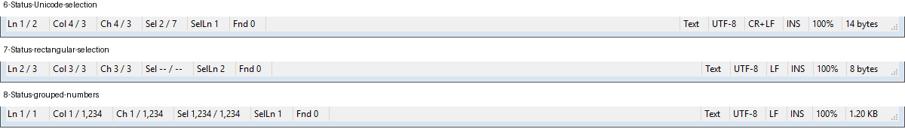
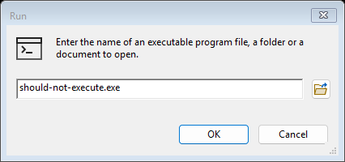

# notepad4 MDI 完整功能一致性验收

基线：notepad4 `3fcfb70fd0d3c8802100c85f7293ccb326aa8b64`。验收日期：2026-11-10（Asia/Singapore）。

## 验收结论

**验收进行中，尚不满足完整一致性通过条件。** 首先更新进度文档，再依据实际实现扩展验收；入口覆盖、自动回归、源码对照与桌面交互分别记录。

全部 418 个静态菜单命令、32 个对话框、27 个工具栏按钮、13 个状态栏字段及上游快捷键条目见 [逐项证据索引](MIGRATION_ACCEPTANCE_INVENTORY.json)。索引中的测试文件引用仅用于定位，不能据此将整项功能标为通过；`pending` 表示该项目的全部语义及边界尚未验收完。

## 本轮检查与证据

| 检查 | 方法 | 结果 |
|---|---|---|
| 菜单入口 | 当前构建导出运行时 `State()`，与原始资源清单比对 | 418/418 已接通；不代表实际执行通过 |
| 文件及集成回归 | MSVC 包装脚本构建，CTest，2026-11-10 15:19 | 两项通过，17.26 秒；最终日志副本 `tmp/acceptance-ctest-final.log` |
| oneAPI 编译兼容及交叉回归 | 2026-11-10 15:48，IntelLLVM 2026.2.0 / Release 与 MSVC / RelWithDebInfo 重新配置、构建并串行运行 CTest | 两套构建均完成，各 2/2 通过（26.27 秒 / 21.89 秒）；包含重复绘制分隔条的 GDI 资源回归。日志 `tmp/oneapi-ctest.log`、`tmp/oneapi-msvc-ctest.log` |
| 工具栏路由 | `UIConsistencyTests.h`，枚举全部按钮定义和对应命令状态 | 27/27 路由检查通过；不代表全部按钮鼠标交互通过 |
| 快捷键目标 | 枚举三个真实已编译快捷键表 | 204 条记录检查通过：199 条上游 + 5 条 MDI；查找窗口由独立过程处理，Ctrl+Tab 被 MDI 覆盖 |
| MDI 快捷键行为 | 测试线程的键状态表 + 真实 `PreTranslateMessage` / `TranslateAccelerator` | 新建、前/后标签切换、Ctrl+W 和 Ctrl+F4 关闭文档通过；无桌面输入注入 |
| 状态栏 | 对照上游 `Notepad4.cpp::UpdateStatusbar` 和 `MsgNotify`，通过真实控件及 `WM_NOTIFY` 检查 | 13 个字段样例、Unicode/矩形选区、千位分组、大小格式，以及行号/查找/编码/换行/覆盖/缩放/CSV 入口的已有和新增回归；本轮修复 B13、B14 |
| 快捷键专有功能 | 长行限制开启、增/减及 0/4096 边界；临时反转自动缩进和只读保护 | 新增回归通过；修复 B15。命令通过 WM_COMMAND 执行，键盘记录另行检查 |
| CSV 设置取消 | 从 C/C++ 切换 CSV 后取消、已在 CSV 时从状态栏打开后取消 | 方案与 CSV 选项保持，回归通过；修复 B16 |
| 浏览按钮图像 | 对照上游 `MakeBitmapButton`，检查运行对话框的按钮图像列表及最终渲染图 | 恢复运行、收藏夹和 Open With 的图像资源；运行按钮图像断言与目视通过，修复 B17 |
| 缩放窗口定位 | 对照上游 `SetToRightBottomEx`，检查状态栏单击打开窗口的屏幕位置关系 | 右下角位置、应用后取消保留缩放回归通过，修复 B18；菜单打开仍居中 |
| 窗口渲染 | 当前构建 `--qa-render tmp/qa-acceptance-final` | 退出码 0，172 张 BMP 和 172 份布局记录；见下方渲染抽查范围 |
| 真实桌面 | computer-use 与 unified-computer-use 均尝试发现窗口 | 阻断：`Computer Use native pipe is unavailable`，系统找不到管道；无窗口可选择 |

字符/字节顺序与矩形选区的新增断言在修正前实际失败，预期分别为 Unicode 选区 `2 / 7` 和矩形选区 `-- / --`。菜单路由之外的快捷键检查也实际报出未路由命令 `40569`。修正后全部新增断言通过。不能仅凭修正前的菜单 418/418 或旧测试通过推断功能完整。

## 状态栏样例范围

本轮对真实状态栏的 13 个字段读取结果做断言：行、列、字符、选区字符/字节、选中行、查找计数、空白分隔、语言、编码、换行、插入/覆盖、缩放和大小。输入包含 `a中😀`、矩形选区及 1,234 个 ASCII 字符，核对字符数与 UTF-8 字节数不同、千位分隔符来自当前系统区域。

通知回归覆盖行号双击、查找双击及目标文档绑定、编码双击、换行单击规范化和双击轮换、覆盖模式双击、缩放单击的定位/应用/取消、CSV 语言双击及取消，并确认另一个文档的正文保持不变。缩放双击按上游不另开第二个对话框。查找计数当前样例为 0，异步统计及其全部边界不属于本轮状态栏样例的通过结论。



## 现有回归的功能范围

以下现有用例均随本轮最终 CTest 运行通过，代表列出的样例，不能外推为整个模块完整通过。

| 模块 | 已执行的代表性证据 | 尚需扩展的验收 |
|---|---|---|
| 文件与编码 | Unicode/DBCS 分块边界、BOM/无 BOM、内嵌 NUL、编码变量、时间戳、DOS 属性、共享冲突、硬链接失败回滚和 ADS | 全部可用代码页的转换/检测一致性；极大文件、网络与磁盘故障组合 |
| 样式 | 上游 lexer 目录逐项加载验证；C++/Python/JSON/Rust/Go/JavaScript 的真实着色样例；内容检测、折叠导航、补全、配对、LaTeX 输入 | 每种语言的完整样式、所有补全/配对上下文、真实 IME 输入 |
| 编辑与查找 | 编码/数字/大小写和行处理样例、替换撤销、正则/通配符/反斜杠、查找窗口文档归属、帮助窗口及部分对话框路径 | 每个命令的全部选区模式、Unicode/只读/撤销边界，以及上游结果对比 |
| 设置与运行时 | 全局/方案/文件制表符分层、取消保护、自动保存历史、会话顺序/活动页/文档状态、后台文件监视、语言确认及隔离注册表 | 真实多进程重启/异常退出、系统集成、长时间后台运行和完整设置组合 |
| MDI 与 UI | 标签重排、层叠/平铺/图标排列、关闭重入、停靠、工具栏打开按钮主区/箭头、布局手柄 | 真实拖动、所有工具栏按钮/下拉、全部焦点和快捷键上下文、多显示器 DPI |
| 打印 | 页面设置模板和页眉/页脚/缩放参数回归 | 实际打印对话框与打印输出、分页/范围/选区、所有打印机设置 |

## 渲染抽查范围

前一轮 `tmp/qa-acceptance-20261110/` 的 172 张图组成 10 张缩略图，全部浏览以发现明显缺图、重叠和裁切；发现 B17 后修正。最终 `tmp/qa-acceptance-final/` 再次完成全套渲染，并放大复查状态栏及运行窗口。没有据此将全部 32 个对话框的所有尺寸、语言和 DPI 组合标为通过。



## 未通过及未覆盖项

- 对话框的真实鼠标、键盘焦点、拖动、输入法、多显示器 DPI 检查尚未进行；内部对话框回归不替代这些检查。
- 实际打印输出、真实系统集成及全部语言/编码/lexer 的端到端组合仍需验收。隔离注册表回归不能证明系统级替换正常。
- 索引中的全部菜单命令需要逐项语义与边界证据，不能把已有测试中出现命令 ID 当作完整覆盖率。

## 复现

```powershell
bash -lc "cmake-build cmake-msvc-build"
ctest --test-dir cmake-msvc-build --output-on-failure
$report = Start-Process .\cmake-msvc-build\multipad4.exe -ArgumentList '--migration-report','tmp/migration-status-check.json' -WindowStyle Hidden -PassThru
$report.WaitForExit()
python tools/check_migration.py tmp/migration-status-check.json
python tools/build_acceptance_inventory.py tmp/migration-status-check.json
```

`--qa-render <输出目录>` 可导出本进程窗口渲染与布局文件；它属于程序内回归产物，不是桌面输入验证。
