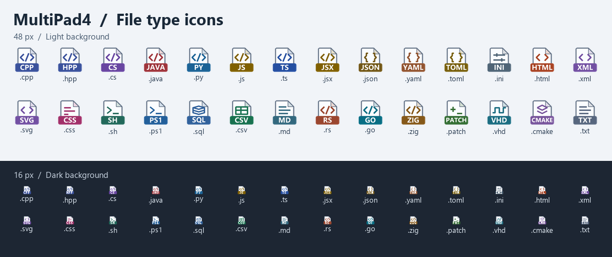

# MultiPad4 file type icons

Every distinct extension in the bundled `config/languages/default.xml`, including
variant extension entries, has a transparent `file-<extension>.ico` asset. Use
lowercase and omit the leading dot: `.cpp` uses `file-cpp.ico`. The prefix avoids
reserved Windows filenames such as `aux`.

The folded paper shape ties the set together. Colors and symbols identify file
families, while the badge identifies the extension. Small sizes abbreviate longer
extensions; the 16 px badge is drawn pixel by pixel. Each ICO contains 16, 24,
32, 48 and 64 px frames. Explorer scales the 64 px frame for larger views.

Open **Settings > File Associations**, check the extensions you want to register,
and click **Save registration**. MultiPad4 registers the checked types for the current user,
points their `DefaultIcon` entries at resources inside `multipad4.exe` (for example,
`"C:\Apps\multipad4.exe",-46061` for `.cpp`), and asks Explorer to refresh
its association cache. Saving also updates old icon paths without changing the
checkboxes. **Save and open Default Apps** saves the same changes and then opens
Windows Settings, where you choose the actual default app. Unchecking a type removes MultiPad4's registration
as a candidate but does not replace an existing Windows default.
**Select all**, **Select none**, and **Invert selection** apply to the full list,
including entries hidden by the filter.

Extensions shared by schemes (such as `.r` and `.inc`) use a neutral icon;
content detection, special filenames and user-added extensions do not create
separate shell associations. The ICO files are build inputs only; do not deploy
`res/icons` next to the executable. Assign each new icon an unused ID in
`resource-ids.txt`; do not renumber or reuse existing IDs because Windows stores them.

Regenerate on Windows with `python tools/generate_file_icons.py` (Python 3.10+,
Pillow and the Windows Segoe UI font). Use `python tools/generate_file_icons.py --check`
to validate coverage, transparency and frame sizes without rewriting.
